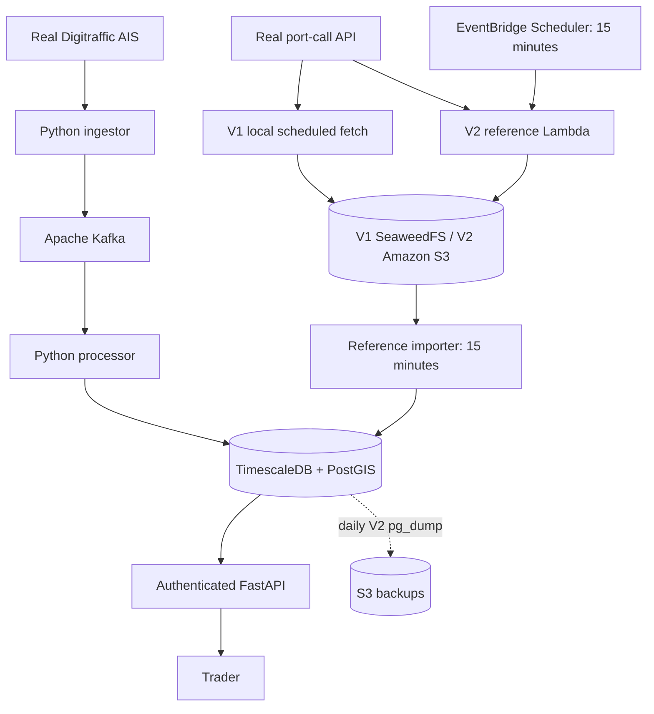

# Architecture

Kafka records use vessel keys. The single processor commits each offset after
the database transaction or durable quarantine completes. A database error stops
the worker with its offset uncommitted; Compose restarts it. PostgreSQL uniqueness
includes the Timescale partition dimension, event time. Observation identity
excludes receipt time and includes source, event time, position and motion values.

The database transaction inserts history, conditionally updates latest state and
advances versioned geofence state. Duplicate events have no second durable effect.
Equal-time conflicting observations remain in history; the first latest value
is retained and inference is not repeated for a tie. This is a deterministic
single-consumer policy, not a general cross-source identity reconciliation system.

Reference imports are a separate, low-frequency path with a transactional import
ledger. The importer checks current-day keys and downloads only unseen snapshots.
After an outage spanning UTC midnight, older snapshots are still in S3 but require
explicit recovery; there is no all-history scan in every cycle.

## Quantified development targets — not established SLOs

- 5 observations/s average, 50/s for a five-minute burst; actual volume unmeasured.
- 5 users and bounded API queries; private pilot currently uses one shared token.
- Receipt-to-queryable p95 ≤10 seconds; requires workload and latency instrumentation.
- 99% monthly read availability; requires external monitoring and a support agreement.
- ≤4 staffed hours to restore, database RPO ≤24 hours; requires a timed recovery drill.
- £100/month all-in ceiling, routine plan ≤£75; AWS cost estimate must be refreshed.

The current implementation establishes correctness boundaries, not these production
claims. Single Kafka broker, database and host share a failure domain. Kafka's
48-hour retention and 5 GiB/partition cap are development bounds, not guarantees
that 48 hours always remain available. There are three position partitions.

## Deliberately deferred

Europe-wide source qualification, cargo inference, trade recommendations, cross-source
identity resolution, notifications/watchlists, raw Kafka-to-S3 archiving, temporal
correction/replay UI, per-user authentication/rate limits, automated code deployment,
and complete disk/lag monitoring with external incident delivery. No Kubernetes,
Flink, generic messaging framework or queue between reference fetching/importing.
