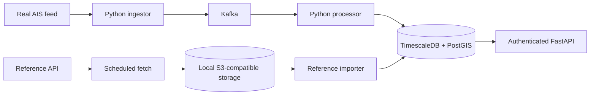

# V1 architecture

Code lives in `src/v1`; external services are implemented in `adapters`. Business
logic does not import AWS APIs. S3 endpoints/credentials and database/Kafka clients
are configured from the grouped environment file.

A transaction persists position history, conditionally updates latest state and
advances port inference. The processor commits its offset only after durable
handling. Idempotent effects support at-least-once processing; they do not establish
complete upstream receipt or a general exactly-once delivery guarantee.
