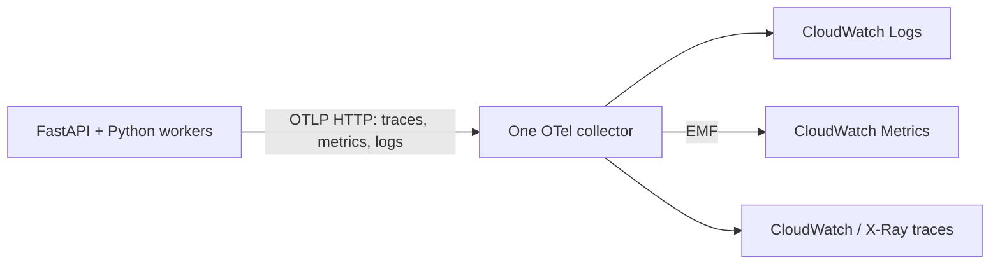

# OpenTelemetry → CloudWatch

V1 exports to the collector's debug output. V2 uses the same application SDK and
switches only the collector exporters. No Prometheus, Grafana, Jaeger or external
monitoring backend is added. The custom host-metrics publisher has been removed.

Signals:

- API requests, errors and duration, with stable route templates on spans.
- Kafka publication → consumption trace propagation inside the event envelope.
- PostgreSQL operation spans, excluding SQL/parameters and exception text.
- Processed/quarantined observation counters and receipt-to-processing delay.
- Root-filesystem free utilization from the collector hostmetrics receiver.
- Backup age from the API's OTel observable gauge and read-only success marker.
- Python application logs with trace/span correlation when inside a span.

`OTEL_TRACES_SAMPLER_ARG=0.01` samples 1% of root traces. Parent decisions propagate
between producer and consumer. `OTEL_METRIC_EXPORT_INTERVAL=60000` is milliseconds;
export timeout is explicitly in seconds. Logs/metrics are not reduced by trace
sampling. Authentication headers, raw URLs and vessel identifiers are never metric
labels or HTTP span attributes. Health probes are excluded. Exporters are batched
and bounded; telemetry failure must not change successful business processing.

Find telemetry after deployment in the
[CloudWatch London console](https://eu-west-2.console.aws.amazon.com/cloudwatch/home?region=eu-west-2).
The Terraform `cloudwatch_console_url` output uses the selected region. Nothing is
visible for this project until infrastructure is deployed and applications export.

The AWS collector configuration was checked with its pinned 0.164.0 binary. Local
SDK propagation/privacy tests and real dependency tests do not establish successful
CloudWatch ingestion; the first deployment must confirm those signals in AWS.
