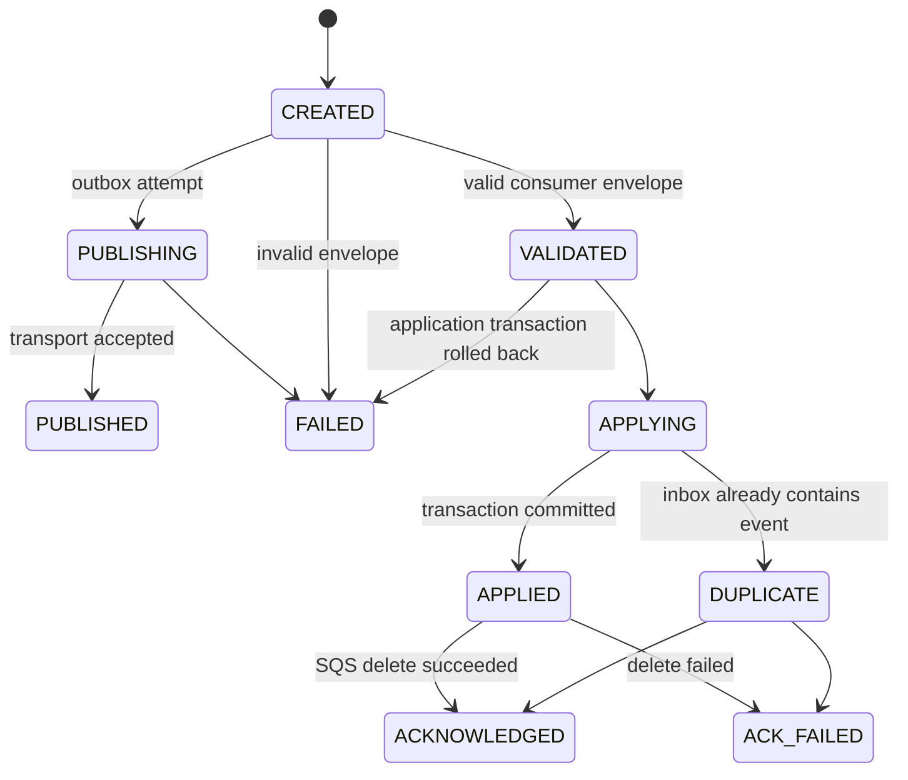

# Process states and trace lineage

An event UUID identifies a logical event; each outbox destination is a separate obligation. A process UUID identifies one publication/delivery attempt, not the trade itself. Trace/span IDs locate sampled timing evidence. Trade revisions, source revisions and inbox records remain the business truth.

## State machines



`APPLYING`, business changes, inbox insertion and `APPLIED`/`DUPLICATE` transitions share one database transaction. If application fails, these transitions roll back and the durable history is `VALIDATED → FAILED`. Log lines emitted inside a rolled-back transaction are provisional; query PostgreSQL for committed lineage. State changes acquire an execution row lock and append a uniquely numbered transition. Illegal edges raise an error. Every retry creates a new execution linked by the same event identity.

A crash can leave `CREATED`/`VALIDATED` attempts unfinished; they are evidence of interruption, not proof that business effects occurred. An `APPLIED` attempt without acknowledgement is ambiguous about SQS deletion. Re-delivery consults the inbox before application. Never infer message loss from a missing trace or a missing final state. Publication accepted before a publisher crash can create duplicates; outbox/inbox semantics remain at-least-once.

## Tracing

HTTP middleware extracts W3C traceparent/tracestate, creates a server span and returns X-Trace-ID. It does not accept caller request IDs as trusted correlation identifiers. Booking, portfolio lock acquisition, reconciliation, market-data writes and valuation have domain spans. Outbox envelopes persist optional trace context at emission. Producer spans continue that context; the transmitted envelope carries the producer context, and consumer spans continue it. No baggage, API tokens, bodies, SQL statements or financial amounts are exported as span attributes. Event UUIDs are trace/log attributes, never metric dimensions.

Sampling is locally capped at the configured ratio rather than trusting a caller's sampled flag. Separate services make independent sampling decisions, so partial traces are possible. State history is stored even if a span is unsampled. Collector/exporter failure may drop telemetry; it must not roll back a committed trade.

Elexon ingestion has CREATED → FETCHING → FETCHED → PERSISTING → SUCCEEDED (or FAILED), plus spans around the import and concurrent dataset fetches. Existing ImportRun states still track RUNNING/SUCCEEDED/FAILED; delivery attempt history is additional operational lineage, not event sourcing or a replacement for trade audit. V2 does not implement a global workflow engine or AWS Step Functions.

## Inspection

Local, from V2:

```sh
docker compose --env-file v2.env exec -T trading python manage.py process_history --identity EVENT_UUID --limit 20
```

AWS, as root from `/opt/renewables/deploy/aws`, uses `docker compose --env-file v2.env` instead. Inspect the source publisher and destination consumer separately. Each schema owns its own history.

Only terminal diagnostic attempts may be pruned, after at least seven days, in batches of at most 1,000. Review counts first, retain incident evidence, then invoke `process_history --prune-days 7 --limit 1000 --confirm`. Unfinished attempts and all business/inbox/outbox records remain. Direct administrator table writes can bypass the application state machine and must be restricted operationally.
